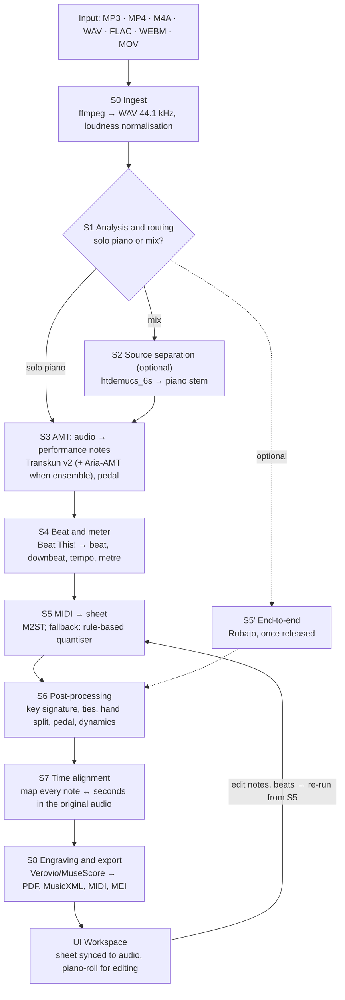
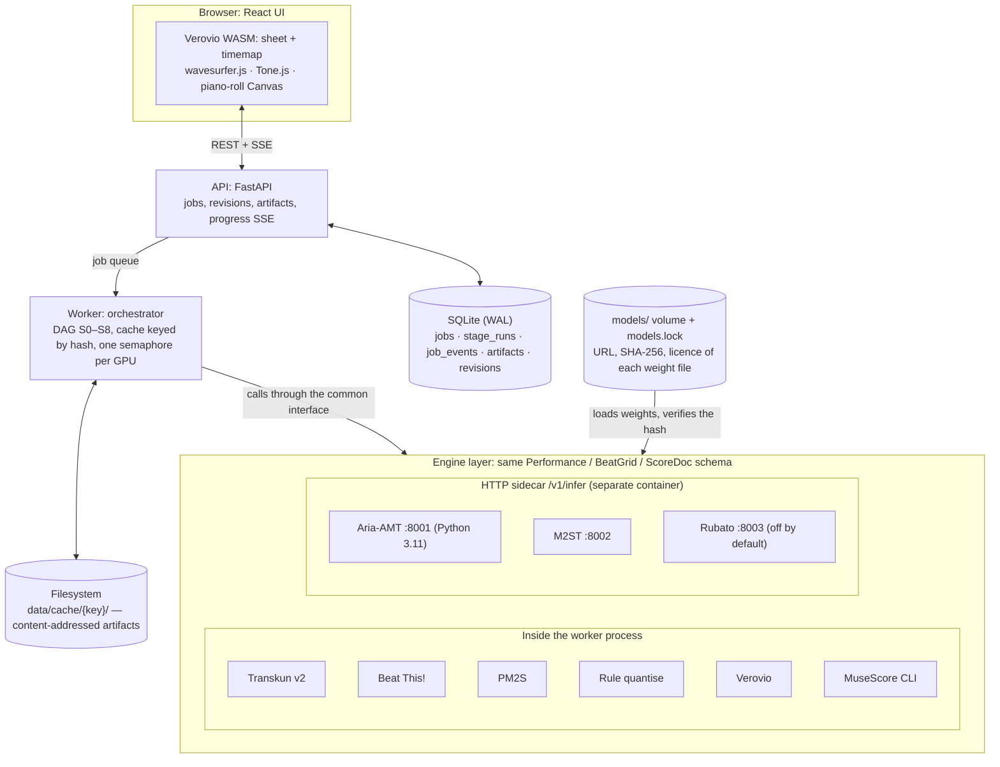

# P2S Local — An application that turns piano music (MP3/MP4) into sheet music, running locally

> **English** · [Tiếng Việt](p2s-spec.vi.md)

> Updated: 2026-10-20. Exported from the Claude Doc "P2S Local — Piano audio/video → Sheet music (run locally)"; diagrams converted to mermaid/tables.
> Decision identifiers of the form `D-xxx` are stable references kept for traceability; the decision log itself is maintained separately and is not published here.

## Summary

Recommendation: build P2S Local on a **cascade architecture with replaceable engines** — Transkun v2 (audio→MIDI) → Beat This! (beat/downbeat) → M2ST (MIDI→MusicXML) → post-processing → Verovio — running fully offline on an on-prem GPU, and keep a slot open for the end-to-end Rubato model once it is released.

- **Why this cascade:** on the ATEPP set (1,495 real recordings that no model had seen during training), Transkun→M2ST is the best open cascade at OMR-NED 85.2 (lower = better). End-to-end Rubato reaches 75.9; Gemini 3.1 Pro (zero-shot) only reaches ~98.6 on ASAP.
- **The real bottleneck is MIDI→score, not the note-listening step:** Transkun already reaches note F1 98.3 on MAESTRO, and feeding reference (oracle) MIDI into the cascade barely improves OMR-NED. Optimisation effort therefore goes into quantisation, hand separation, beat/downbeat and the correction UI.
- **v1 benchmark targets:** OMR-NED on ATEPP ≤ 86, onset F1 on MAESTRO ≥ 97.5, winning ≥ 50% in blind (ABX) comparisons against Songscription and Piano2Notes on the internal real-world set.
- **UI:** local web app (FastAPI + React) — upload MP3/MP4, view the sheet in sync with the audio, edit notes on the piano-roll and rebuild the sheet, export PDF/MusicXML/MIDI.
- **Timeline:** 12 weeks, 2 engineers (1 ML/audio, 1 full-stack); an end-to-end MVP in week 6, the full benchmark report in week 10.

## 1. Existing commercial applications

The tools that give the best results today all run in the cloud; AnthemScore is the only significant offline option but uses an older-generation model. No vendor publishes a controlled benchmark — Songscription itself states that its comparison is not a controlled accuracy benchmark. This is the gap for a local app built on open SOTA models.

| Application | Deployment | Input → output | Pricing | Strengths | Limitations | Independent test (sspai, 9 tools, piano audio isolated from songs) |
| --- | --- | --- | --- | --- | --- | --- |
| [Songscription](https://www.songscription.ai/blog/best-ai-piano-transcription-software) | Web, cloud | Audio file, YouTube link, mic → PDF, MIDI, MusicXML, Guitar Pro | Free: unlimited 30-second clips; paid plans | Piano-focused, has a piano-roll editor to fix things before export | Needs internet; data leaves your machine | Top group |
| [AnthemScore](https://www.songscription.ai/blog/songscription-vs-anthemscore) (Lunaverus) | Desktop Win/Mac/Linux, offline | Audio → MusicXML, MIDI, PDF | One-time purchase; 30-day trial limited by length | Runs offline; edit on the spectrogram | Older model than the new cloud models; weak on dense mixes | Top group |
| [Klangio Piano2Notes](https://apps.appfollow.io/ios/piano2notes/1589420929?country=ru) | Web + iOS/Android, cloud; dev API available | MP3/mic → MIDI, PDF, MusicXML | Freemium/subscription | Piano polyphony specialist; Transcription Studio ecosystem, DAW plugin | Network required; cannot separate multiple instruments; admits it does not catch 100% of notes | Fair group |
| Ivory (Piano-to-Notes AI) | App, cloud | Piano audio → sheet | Paid | — | — | Fair group |
| [La Touche Musicale PianoConvert](https://latouchemusicale.crunch.help/en/conversion-apps/quelle-app-choisir-selon-votre-objectif-piano-guitare-sax-voix) | Web, cloud | Audio → sheet/MIDI/MusicXML | Subscription | Has a dedicated app per instrument | Poor results on piano isolated from songs | Poor group |
| ScoreCloud, Melody Scanner, Logic Pro (audio→MIDI) | Desktop/app | Audio → notation/MIDI | Varies | Quick melody recording | Not suited to piano polyphony | Poor group |
| MuseScore Studio 4 | Desktop, offline | Score editor/engraver only | Free | Beautiful engraving, imports MusicXML/MIDI | Does not transcribe from audio by itself | — (used as the viewer/editor for output) |

The independent test on [sspai](https://sspai.com/post/103825) uses low-quality piano audio isolated from pop songs, so the results reflect the "song with a backing piano" scenario. Every vendor acknowledges that quality depends more on the recording than on the tool, and that separating the stem first clearly improves accuracy ([source](https://www.songscription.ai/blog/best-mp3-to-sheet-music-converters)).

## 2. Research and open models (SOTA as of 10/2026)

The problem has two halves of very different difficulty. Audio → performance MIDI is nearly saturated (note F1 97–98% on MAESTRO); performance MIDI → sheet (measures, note values, hand separation, key signatures) is still often wrong. The end-to-end model Rubato (5/2026) shows that the intermediate MIDI representation is itself the ceiling of the cascade approach.

### 2.1 Audio → performance MIDI (AMT)

| Engine | Architecture | Note F1 MAESTRO | Note+velocity F1 | Install / licence | Role in P2S |
| --- | --- | --- | --- | --- | --- |
| [Transkun v2](https://pypi.org/project/transkun/2.0.0) | Transformer scoring time intervals + semi-CRF | 98.3 | 97.9 | `pip install transkun`; MIT | Default engine |
| [Aria-AMT](https://github.com/EleutherAI/aria-amt) (EleutherAI) | Whisper-style seq2seq | 97.6 | 96.4 | Python 3.11; supports int8 + `torch.compile`; verify licence | Second engine for "real-world" recordings (YouTube, phone); ensemble |
| [ByteDance high-res](https://github.com/AK391/piano_transcription) (Kong et al.) | CRNN regressing onset/offset, with a pedal model | 96.8 | 95.0 | `pip install piano_transcription_inference` | Backup pedal source |
| MT3 (Google) | T5 multi-instrument | 95.7 | — | verify licence | Only used when the piece has several instruments |
| [hFT-Transformer](https://github.com/sony/hFT-Transformer) (Sony) | Frequency–time hierarchical Transformer | SOTA at ISMIR 2023 | — | Public checkpoint available | Optional, for comparison |

The F1 figures come from the comparison table in the [Rubato paper](https://arxiv.org/html/2605.24291v1) (MAESTRO test, 177 files, 50 ms onset tolerance). Note on robustness: [Edwards et al.](https://arxiv.org/pdf/2402.01424) show that these models overfit the acoustic characteristics of MAESTRO, so the P2S benchmark must include an out-of-distribution set (phone, upright piano, YouTube).

### 2.2 Beat, downbeat, measures

- [Beat This!](https://huggingface.co/schism-audio/beat-this-mlx) (CPJKU, ISMIR 2024, MIT): a transformer over 50 fps log-mel, no DBN post-processing needed. On ASAP it reaches beat F1 79.9 and downbeat F1 64.9. There is a small version with 2.1M parameters and an ONNX version.
- Downbeat is the weakest link: with correct reference downbeats, Piano-A2S improves OMR-NED by 8.8 points (86.6 → 77.8). Consequence for the design: the UI must let users adjust tempo, metre and the first measure.

### 2.3 Performance MIDI → sheet

- **PM2S** (Liu et al., 2022): a CRNN with separate heads for beat, key, time signature, note value and staff (hand). It keeps the performance feel but the sheet lacks long-range coherence.
- **[M2ST](https://arxiv.org/html/2410.00210v1)** (Beyer & Dai, ISMIR 2024): a RoFormer seq2seq that emits MusicXML tokens directly, guessing both trills and stem direction; code and model on GitHub. Trained on a closed MuseScore corpus, so retraining is hard.
- **Piano-A2S** (Zeng et al., IJCAI 2024): audio → \*\*kern in blocks of 5 measures, needs input downbeat positions.
- **MuseScore MIDI import**: rule-based quantisation, used as the low baseline.

### 2.4 End-to-end: Rubato (UW + AI2, 5/2026, NeurIPS 2026)

- Fast Conformer encoder + Transformer decoder (~180M parameters, Canary-180M-Flash architecture). Emits InterMo: a text sequence of "interval" (duration in beats) and "moment" (key press/release) tokens with timestamps, so the sheet is aligned to the audio by construction.
- Data: MAESTRO (159 hours), (n)ASAP (30 hours), synthetic PDMX (2,071 hours, 8 VST pianos × 2 room configurations).
- Speed: ~21× real-time for the sheet mode on one L40S (beam 4), 40-second decode windows, 50% hop.
- Status: [the authors promise to release model and code upon publication](https://neurips.cc/virtual/2026/poster/149838); the model licence is unclear. P2S treats Rubato as an optional plugin and does not depend on it.

### 2.5 Source separation (songs with piano mixed with other instruments)

- **htdemucs_6s** (Meta): 6 stems including piano, ~105 MB, MIT weights according to [mlx-audio-separator](https://huggingface.co/ssmall256/mlx-audio-separator).
- **BS-RoFormer-SW**: 6 stems including piano, ~667 MB, weight licence unclear — internal use only until verified.

### 2.6 Published reference scores (OMR-NED on ATEPP-filtered)

Source: table 2 of the Rubato paper (arXiv 2605.24291). ATEPP-filtered, n = 1,495 recordings. Lower OMR-NED = less correction work.

| System | OMR-NED ↓ (± 95% CI) | Recordings with no output |
| --- | --- | --- |
| Rubato (end-to-end) | 75.9 ± 0.9 | 0 |
| **Transkun → M2ST (default of P2S v1)** | **85.2 ± 0.5** | 1 |
| Aria-AMT → M2ST | 85.6 ± 0.4 | 0 |
| ByteDance → M2ST | 86.5 ± 0.4 | 0 |
| MT3 → M2ST | 88.8 ± 0.3 | 0 |
| Beat This! → Piano-A2S | 88.9 ± 0.3 | 0 |
| Transkun → PM2S | 92.0 ± 0.2 | 8 |
| ByteDance → PM2S | 92.5 ± 0.2 | 1 |
| Aria-AMT → PM2S | 93.2 ± 0.2 | 3 |
| MT3 → PM2S | 93.3 ± 0.2 | 135 |

P2S targets: v1 ≤ 86, v2 ≤ 80 (see section 6.5).

On ASAP, replacing predicted MIDI with reference MIDI does not improve the cascade's OMR-NED, so this gap mainly comes from the MIDI → sheet step. Gemini 3.1 Pro zero-shot reaches about 98.6 on ASAP (a different set, hence not in the table), i.e. general-purpose LLMs are not yet usable for this task.

## 3. Proposed pipeline

The pipeline has 9 stages, each stage being an interface with a swappable engine; the default is the Transkun → Beat This! → M2ST cascade, with a source-separation branch when the audio is a song and an end-to-end Rubato branch when the model is available. Every intermediate output is cached by hash, so when the user edits notes or beats only the affected stages re-run.



Dashed lines are branches that only run when needed: source separation when S1 detects a song with other instruments, and Rubato replacing all of S3–S5 when weights are available.

| Stage | In → out | Default engine | Alternative | Design notes |
| --- | --- | --- | --- | --- |
| S0 Ingest | MP3/MP4/M4A/WAV/FLAC/WEBM/MOV → WAV 44.1 kHz stereo | ffmpeg | — | EBU R128 loudness normalisation; start/end trimming; SHA-256 of the content as the cache key |
| S1 Analysis & routing | WAV → label {solo piano, mix} + quality warnings | Ratio of piano stem energy to total energy (htdemucs_6s run quickly) | Audio tagger | Default threshold 0.8, tunable in config; warns about clipping, low sample rate, long silence |
| S2 Source separation (optional) | Mix → piano stem | htdemucs_6s | BS-RoFormer-SW (internal) | Only runs when S1 reports a mix or the user switches it on |
| S3 AMT | Audio → performance notes (pitch, onset, offset, velocity) + pedal CC64 | Transkun v2 | Aria-AMT, ByteDance; Transkun + Aria ensemble | Ensemble: match notes by pitch, 50 ms onset tolerance; notes seen by only one engine are kept by a configurable voting rule |
| S4 Beat & meter | Audio → beats, downbeats, tempo curve, time signature | Beat This! final0 | Beat This! small (CPU) | Time signature inferred from the number of beats between two downbeats; user hints (BPM, metre) take precedence |
| S5 MIDI → score | Notes + beats → MusicXML (2 staves) | M2ST | PM2S; rule-based quantiser (beat grid + dynamic programming) | The rule quantiser is the fallback that always runs, no GPU needed |
| S5′ End-to-end | Audio → timestamped MusicXML | — | Rubato (when released) | Replaces S3–S5; still goes through S6–S8 |
| S6 Post-processing | MusicXML → clean MusicXML | Internal rule set (music21/partitura) | — | Key signature by key, rest merging, ties across bar lines, clef/ottava, pedal from CC64, dynamics from velocity quantiles, total-duration check per measure |
| S7 Time alignment | Score + performance → map `note_id ↔ (onset_s, offset_s)` | DTW performance–score alignment | Timestamps from Rubato | Used to highlight notes during audio playback |
| S8 Engraving & export | MusicXML → SVG, PDF, MIDI, MEI | Verovio | MuseScore 4 CLI for nicer PDFs | Exports both performance MIDI and quantised MIDI |

**Three presets for users:**

1. **Accurate (GPU):** Transkun + Aria-AMT ensemble, M2ST, PDF via MuseScore.
2. **Fast (CPU):** Transkun on CPU, Beat This! small, rule-based quantiser.
3. **Song with vocals/band:** like preset 1 but with S2 source separation enabled.

## 4. Product spec

P2S Local v1 takes one audio/video file containing piano and returns readable two-staff sheet music, synchronised with the audio, editable and exportable to PDF/MusicXML/MIDI — all running on a personal machine or an on-prem server, with no data sent outside. Target users: piano learners, teachers, arrangers, and internal teams that need to transcribe in bulk.

### 4.1 Functional requirements

| ID | Requirement | Priority | Acceptance criteria |
| --- | --- | --- | --- |
| FR-01 | Upload MP3, MP4, M4A, WAV, FLAC, WEBM, MOV | P0 | Files ≤ 500 MB and ≤ 20 minutes decode; broken files report a clear error and never hang a job |
| FR-02 | Select the start/end range on the waveform before running | P1 | Only the selected range is processed; timestamps in the output are relative to the original file |
| FR-03 | Choose a preset; customise the AMT engine, source separation, BPM/metre/key hints, quantise grid (1/8, 1/16, 1/32, triplet), pedal, dynamics | P0 preset, P1 customisation | Every parameter is stored in the job manifest |
| FR-04 | Per-stage progress in real time; cancel a job | P0 | Updates over SSE ≤ 1 second apart; cancelling frees the GPU within ≤ 5 seconds |
| FR-05 | Display two-staff sheet music | P0 | Rendered with Verovio; zoom, page navigation |
| FR-06 | Play the original audio in sync with the sheet | P0 | Highlights the measure/note being played; clicking a measure jumps to that point in time |
| FR-07 | Play the sheet as synthesised piano, A/B against the original audio | P1 | Switching does not lose the playback position |
| FR-08 | Piano-roll: add/delete/drag notes, edit velocity, edit beat/downbeat, then "Rebuild sheet" | P0 notes, P1 beat | Only S5–S8 re-run; rebuilding a 3-minute piece takes ≤ 15 seconds on GPU |
| FR-09 | Quick edits on the sheet: change key/metre, move a note to the other staff, transpose | P2 | Changes appear in the exported MusicXML |
| FR-10 | Export PDF, MusicXML (.mxl), MIDI (performance + quantised), MEI, piano stem | P0 PDF/MusicXML/MIDI, P1 the rest | Files open in MuseScore 4 without errors |
| FR-11 | Job history: rename, search, delete | P0 | Data lives only in the local data directory |
| FR-12 | CLI for batch runs | P0 | `p2s transcribe in.mp4 -o out/ --preset accurate` gives the same result as the UI |
| FR-13 | Local REST API | P0 | OpenAPI spec generated automatically |
| FR-14 | Engines page: version, licence, weight hash, GPU status | P1 | Warns when weights carry a restrictive licence |
| FR-15 | Vietnamese and English interface | P1 | Switching language requires no reload |

### 4.2 Non-functional requirements

| ID | Property | Target |
| --- | --- | --- |
| NFR-01 | Offline | After the first weight download there are no outbound requests; air-gapped mode loads weights from a directory |
| NFR-02 | Speed | 3-minute piece, Accurate preset, ≤ 60 seconds on one RTX 4090/L40S-class GPU; Fast preset ≤ 5 minutes on an 8-core CPU (target, measured in Phase 3) |
| NFR-03 | Memory | Peak VRAM ≤ 12 GB (engines run sequentially, unloaded after use); RAM ≤ 16 GB |
| NFR-04 | Robustness | If S3 succeeds the job always has a sheet: M2ST error/timeout → fall back to the rule-based quantiser; rate of jobs with no output = 0 on the benchmark set |
| NFR-05 | Reproducibility | Same input + config + engine versions → byte-identical output; every output ships with a manifest (versions, weight hashes, config) |
| NFR-06 | Privacy | Option to auto-delete jobs after N days; no telemetry |
| NFR-07 | Extensibility | Adding an engine = one class + one config entry, with no core changes |
| NFR-08 | Platform | Linux + NVIDIA CUDA 12.x primary; macOS Apple Silicon and Windows (WSL2) at "it runs" level |

### 4.3 Out of scope for v1

- Real-time transcription while playing; instruments other than piano (separated only to obtain the piano).
- Fingering, simplified versions for beginners, OMR from sheet images.
- Transcription from keyboard images in video — deferred to v3.
- Downloading audio from YouTube: off by default because of copyright and terms of service.

## 5. System design

The architecture has three layers: the web UI running in the browser, the Python API + orchestrator, and an abstract engine layer made of in-process engines and "sidecar" engines running in separate containers over HTTP. The engine layer is the crux: every model has its own dependencies (Aria-AMT needs Python 3.11, M2ST pins its own torch version), so isolating them lets us upgrade or swap models without touching the core.



The worker only knows the interface; switching Aria-AMT, M2ST or enabling Rubato is one entry in `configs/engines.yaml`, with no core code changes.

### 5.1 Tech stack

| Layer | Choice | Rationale |
| --- | --- | --- |
| Frontend | React 18 + TypeScript + Vite, TanStack Query, Zustand, i18next | Widely used, easy to hire for, fast hot reload |
| Sheet rendering | Verovio (WASM, LGPL-3.0) + `renderToTimemap` | Renders MusicXML/MEI to SVG and provides a time map to highlight during playback |
| Audio in the UI | wavesurfer.js v7 (waveform, range selection, beat markers), Tone.js + piano sample set (synthesised sheet playback) | Runs entirely in the browser |
| Piano-roll | Hand-written Canvas (or PixiJS above 10,000 notes) | Needs smooth note editing on long pieces |
| API | Python 3.11 (uv), FastAPI, Pydantic v2, sse-starlette | Same language as the ML engines; auto-generated OpenAPI |
| Storage | SQLite (WAL) via SQLModel + filesystem for artifacts | No external services needed to run locally |
| Queue | A `jobs` table in SQLite, workers claim jobs with `UPDATE … RETURNING` | Enough for one user; the `JobQueue` interface allows switching to Redis/Postgres for multi-user servers |
| Music processing | ffmpeg, PyTorch 2.x + CUDA 12, music21, partitura, Verovio Python, MuseScore 4 headless (PDF) | Standard libraries in the MIR community |
| Packaging | Docker Compose (GPU via NVIDIA Container Toolkit); direct install with `uv tool install` for dev | One command to start on an on-prem server |

### 5.2 Engine interface

Every engine returns the same Pydantic schema, so the orchestrator, cache and benchmark do not need to know what the engine underneath is.

```python
class NoteEvent(BaseModel):
    pitch: int              # MIDI 21–108
    onset: float            # seconds, relative to the original file
    offset: float
    velocity: int           # 1–127
    confidence: float | None = None

class Performance(BaseModel):
    notes: list[NoteEvent]
    pedals: list[tuple[float, float]]   # sustain CC64 (on, off)
    engine: EngineInfo                  # id, version, weights_sha256, license, device

class BeatGrid(BaseModel):
    beats: list[float]
    downbeats: list[float]
    time_signatures: list[tuple[float, str]]   # (time, "3/4")
    tempo_bpm: list[tuple[float, float]]

class ScoreDoc(BaseModel):
    musicxml: bytes
    alignment: dict[str, tuple[float, float]] | None   # note_id → (onset, offset)
    key: str | None
    warnings: list[str]                                 # suspicious measures, fallback used

class Separator(Protocol):        # S2
    def separate(self, audio: AudioRef, stem: Literal["piano"]) -> AudioRef: ...
class Transcriber(Protocol):      # S3
    def transcribe(self, audio: AudioRef, opts: AMTOptions) -> Performance: ...
class BeatTracker(Protocol):      # S4
    def track(self, audio: AudioRef, hints: MeterHints) -> BeatGrid: ...
class ScoreBuilder(Protocol):     # S5
    def build(self, perf: Performance, grid: BeatGrid, opts: ScoreOptions) -> ScoreDoc: ...
class EndToEnd(Protocol):         # S5′
    def transcribe_score(self, audio: AudioRef, opts: ScoreOptions) -> ScoreDoc: ...
```

Engines and presets are declared in YAML (`configs/engines.yaml`, `configs/presets.yaml`); adding a new engine only takes one class and one config entry.

**Sidecar contract:** `GET /v1/info` (EngineInfo + device), `GET /v1/health`, `POST /v1/infer` (multipart audio or JSON `Performance` + options → JSON with the same schema). A sidecar can run on another GPU node in the internal network just by changing `url`.

### 5.3 Data, cache and re-runs

- **SQLite tables:** `jobs` (ULID id, name, status, preset, params, input_sha256), `stage_runs` (stage, engine, cache_key, duration, peak VRAM, RTF), `artifacts` (kind, path, sha256), `revisions` (the user's note/beat patches, linked to the source artifact), `job_events` (progress log for SSE).
- **Cache key** = SHA-256 of (input_sha256, stage, engine_id, engine_version, weights_sha256, stage params, cache key of the previous stage). Artifacts are stored content-addressed in `data/cache/<key>/`, so re-uploading the same file or changing a parameter at S5 reuses S0–S4.
- **Re-running after edits:** every "Rebuild sheet" creates a new revision; the orchestrator walks the DAG and runs only the stages whose cache key changed.
- **GPU scheduling:** one semaphore per GPU; engines load lazily and unload after the stage finishes, keeping peak VRAM ≤ 12 GB. CPU stages (S0, S6, S8) run in parallel.
- **Manifest:** every job emits `manifest.json` with the P2S version, engines, weight hashes and config — the condition for NFR-05 and for the benchmark.

### 5.4 REST API (local, prefix `/api/v1`)

| Method | Path | Description |
| --- | --- | --- |
| POST | `/jobs` | Multipart: `file`, `preset`, `params` (JSON), `range` → `{job_id}` |
| GET | `/jobs` | List jobs, cursor pagination |
| GET | `/jobs/{id}` | Status, stages, artifacts, warnings |
| GET | `/jobs/{id}/events` | SSE stream of per-stage progress |
| POST | `/jobs/{id}/cancel` | Cancel the job, free the GPU |
| DELETE | `/jobs/{id}` | Delete the job and artifacts that are no longer referenced |
| GET | `/jobs/{id}/artifacts/{kind}` | Download `pdf`, `mxl`, `mid`, `mid_quantized`, `mei`, `svg`, `timemap`, `stem_piano`, `manifest` |
| POST | `/jobs/{id}/revisions` | Body: note/beat patches + `score_options` → re-run from S5 → `{revision_id}` |
| GET | `/engines` | Engines, versions, licences, health status |
| POST | `/engines/{id}/weights` | Download weights (online only) or load from a directory |

### 5.5 UI design

The main screen is the **Workspace**: the sheet in the middle, the transport and waveform at the bottom, the piano-roll as a drawer that pulls up, and a right-hand panel showing per-measure warnings. Every edit leads to a single "Rebuild sheet" button.

```text
┌───────────────────────────────────────────────────────────────────────┐
│ Track title · Accurate preset              [Rebuild sheet] [Export ▾] │
├───────────────────────────────────────────────┬───────────────────────┤
│ Sheet (Verovio) · click a measure to jump to  │ Info                  │
│ that moment                                   │   Key · metre · tempo │
│                                               │ Warnings              │
│   [highlighted measure being played]          │  Wrong total duration │
│                                               │  Unusual note density │
│                                               │   Fallback used       │
│                                               │ Engines used          │
│                                               │   Transkun v2 · M2ST  │
├───────────────────────────────────────────────┴───────────────────────┤
│ ▶ Play  Speed 0.5–1.0×  Loop A–B  Original audio ↔ Synthesised piano  │
├───────────────────────────────────────────────────────────────────────┤
│ Waveform · draggable beat/downbeat markers                            │
├───────────────────────────────────────────────────────────────────────┤
│ Piano-roll (pull-up drawer) · notes coloured by right / left hand     │
└───────────────────────────────────────────────────────────────────────┘
```

Editing notes on the piano-roll or dragging beat markers only marks a draft; the sheet changes only when "Rebuild sheet" is pressed, so users can gather several edits into a single re-run.

| Screen | Main content |
| --- | --- |
| Library | Job list: name, duration, preset, status, page-1 thumbnail; search, delete |
| Create job | Drag and drop a file; waveform for range selection; preset picker; advanced panel (BPM, metre, key, quantise grid, source separation) |
| Processing | S0–S8 progress bar, ETA, condensed log, cancel button; the sheet appears page by page as S8 finishes each page |
| Workspace | Verovio sheet with audio-driven highlighting; click a measure to jump; transport (0.5–1.0× speed, A–B loop, switch between original audio and synthesised piano); waveform with draggable beat/downbeat markers; piano-roll coloured by hand; warning panel (measures with a wrong total duration, unusual note density, fallback used) |
| Engines & Settings | GPU, engines, licences, weight hashes, data directory, auto-delete after N days, language |
| Benchmark viewer (internal) | Results tables and side-by-side comparison of two systems on the same piece, used for blind evaluation |

### 5.6 Repo structure

```text
p2s/
├── apps/web/                    # React + Vite UI
├── p2s/                         # Python package
│   ├── api/                     # FastAPI routers, SSE
│   ├── core/                    # schemas, pipeline DAG, cache, manifest
│   ├── engines/                 # transkun.py, beat_this.py, pm2s.py, rulequant.py, sidecar_client.py
│   ├── post/                    # MusicXML cleanup, key signature, hand split, dynamics
│   ├── render/                  # verovio, musescore, timemap
│   ├── worker/                  # queue, GPU scheduling
│   └── cli.py
├── sidecars/{aria_amt,m2st,rubato}/   # Dockerfile + server.py for each engine
├── bench/                       # datasets/, systems/, metrics/, reports/
├── configs/{engines.yaml,presets.yaml,models.lock}
├── docker-compose.yml
└── tests/{unit,golden,contract,e2e}
```

### 5.7 Deployment

- **Docker Compose:** `web` (nginx serving the static UI), `api`, `worker` (GPU), `aria-amt` and `m2st` (GPU sidecars), `rubato` (off by default). The `models/` volume holds the weights; `models.lock` records the URL, SHA-256 and licence of every file.
- **Dev/single-machine mode:** `uv tool install p2s && p2s serve` runs the API + worker + static UI in one process, and sidecar engines switch themselves off when Docker is absent.
- **Air-gapped:** `p2s weights import /path/to/bundle` loads pre-downloaded weights; on startup the hashes are checked against `models.lock`.
- **Desktop (v2):** wrap in Tauri if a one-click app is needed for non-technical users.

### 5.8 Testing

- **Unit:** schemas, cache key, MusicXML post-processing (total duration, ties, key signatures).
- **Golden:** 10 short clips → MusicXML snapshots; byte-equal for the same engine versions, compared by OMR-NED against an allowed threshold when an engine is upgraded.
- **Contract:** every engine (sidecars included) passes the same suite of schema, time-range and empty/silent-audio behaviour tests.
- **E2E:** Playwright runs the flow upload → process → edit notes → rebuild → export PDF.
- **Performance:** RTF and peak VRAM are measured on the on-prem GPU runner on every merge to the main branch.

## 6. Benchmark against SOTA

The benchmark measures 5 levels (note → beat → sheet → listening → users) on 5 datasets and 5 groups of competitors. The two go/no-go metrics are **OMR-NED on ATEPP-filtered** (sheet correction effort) and the **ABX win rate** of piano players on the internal real-world set.

### 6.1 Evaluation levels and metrics

| Level | Question | Metric | Tooling |
| --- | --- | --- | --- |
| L1 Notes | Are the right notes heard? | Onset F1 (50 ms), onset+offset F1, +velocity F1, pedal F1 | mir_eval, `transkunEval` |
| L2 Beats | Are the barlines placed correctly? | Beat F1, downbeat F1 (70 ms tolerance) | mir_eval.beat |
| L3 Sheet | How far is the sheet from the original? | **OMR-NED** (primary), MUSTER (MeanER + pitch, missing, extra, onset, offset, voice and hand errors), alignment-free MV2H | [VeroSim](https://github.com/btrkeks/verosim) (OMR-NED, Verovio parser), MUSTER tooling, [MV2H](https://arxiv.org/pdf/1906.00566) |
| L4 Listening | Does the rendered sheet sound like the recording? | Render the sheet → audio (FluidSynth + piano soundfont), compare with the original via chroma-DTW and CLaMP 3 embedding similarity | Following the [dual evaluation](https://www.alphaxiv.org/abs/2608.04511) framework (8/2026) |
| L5 Users | Would a pianist want to use it? | ABX win rate (Bradley–Terry model), minutes to correct a piece into the right score in MuseScore per minute of music, readability score 1–5 | Benchmark viewer |
| System | Does it actually run locally? | End-to-end time, RTF, peak VRAM/RAM, number of jobs with no output | `stage_runs` table |

### 6.2 Datasets

| Set | Content | Used for | Notes |
| --- | --- | --- | --- |
| MAESTRO v3 test | 177 Disklavier pieces, MIDI alignment ~3 ms | L1 | Direct comparison with published numbers |
| MAPS ENSTDkCl/Am | Real piano, studio different from MAESTRO | L1 out-of-distribution | Catches acoustic overfitting |
| ASAP test (102) + ASAP-Beyer (25) | Audio + score + beats | L2, L3 | Contamination: M2ST was trained on 98/102 pieces; report only with a flag |
| ATEPP-filtered | 1,495 recordings / 106 works, excluding pieces whose score comes from ASAP | L3 primary, L4 | The fairest set: no system has trained on it |
| P2S-Real (built in-house) | 60 clips of 30–90 seconds: 20 phone recordings (upright/digital piano), 20 pop/Vietnamese-song covers, 20 songs with piano mixed with vocals/band | L3, L4, L5, comparison with commercial apps | Ground-truth MusicXML cross-checked by 2 piano players; only audio we have the rights to use |

### 6.3 Systems compared

| Group | Systems | How to run |
| --- | --- | --- |
| P2S | Accurate preset, Fast preset, ablations (no ensemble, PM2S instead of M2ST, no S6) | `p2s transcribe` batch |
| Open cascades | Transkun→PM2S, Aria→M2ST, ByteDance→M2ST, Transkun→MuseScore import | Adapters in `bench/systems` |
| End-to-end | Rubato (when weights are available) | Sidecar |
| Commercial | Songscription, Klangio Piano2Notes, AnthemScore, PianoConvert | Manual upload or via API (Klangio has a dev API), export MusicXML; record the date, version and plan; run on P2S-Real + 50 sampled ATEPP pieces to keep costs down; comply with the terms of service |
| General-purpose LLM (reference) | Gemini 3.1 Pro zero-shot, as in the Rubato paper | Benchmark only, not in the app |

### 6.4 Protocol

1. Every system receives the same file: WAV 44.1 kHz with loudness normalised; if an app does not accept WAV, use MP3 320 kbps and record that.
2. Use each system's default configuration; do not hand-tune the output.
3. A system that returns no output counts as a failure; report both the mean over successful items and the failure count.
4. Average over recordings; 95% confidence intervals from 10,000 bootstrap resamples; paired comparisons with the Wilcoxon signed-rank test, Holm correction.
5. Break results down by genre (classical, pop, jazz) and recording condition (studio, phone, mix).
6. Human evaluation: 5 piano players of intermediate level or above, each rating 40 random ABX pairs with system names hidden; measure correction time in MuseScore on 10 pieces.
7. Contamination control: no fine-tuning on ATEPP or P2S-Real; an appendix table records which pieces were in which engine's training data.
8. Reproducibility: `p2s-bench run --suite atepp --system p2s:accurate` writes Parquet, generates an HTML report, and includes the manifest of every system.

### 6.5 Targets

| Metric | Set | Reference | v1 (week 10) | v2 |
| --- | --- | --- | --- | --- |
| Onset F1 | MAESTRO test | Table 2.1 | ≥ 97.5 | ≥ 98.0 |
| Onset F1 | MAPS | 88.4 ([Edwards et al.](https://arxiv.org/pdf/2402.01424), not trained on MAPS) | ≥ 85 | ≥ 88 |
| Downbeat F1 | ASAP | Section 2.2 | ≥ 64 | ≥ 68 |
| OMR-NED ↓ | ATEPP-filtered | Table 2.6 | ≤ 86 | ≤ 80 |
| MUSTER MeanER ↓ | ASAP | Measure the Transkun→MuseScore import baseline in Phase 1 | ≥ 30% below the baseline | ≥ 45% below |
| ABX win rate | P2S-Real | — | ≥ 50% against Songscription and Piano2Notes | ≥ 60% |
| Correction minutes / minute of music | P2S-Real | Best commercial app | ≤ 1.0× | ≤ 0.7× |
| 3-minute piece runtime | RTX 4090-class GPU | — | ≤ 60 seconds | ≤ 30 seconds |
| Jobs with no output | All sets | Tkun→PM2S fails on 8 ATEPP pieces | 0 | 0 |

### 6.6 Benchmark tooling design

- `bench/datasets`: each adapter returns `(audio, gt_score, gt_midi, gt_beats, meta)`; downloads and verifies hashes, and never packages data under a restrictive licence.
- `bench/systems`: adapters for local engines, sidecars, and a "folder" adapter that reads MusicXML exported from commercial apps per `manifest.csv`.
- `bench/metrics`: a metric registry (mir_eval, VeroSim, MUSTER, MV2H, chroma-DTW, CLaMP 3); every metric takes normalised MusicXML/MIDI.
- Results are stored as Parquet and queried with DuckDB; the HTML report has tables, confidence intervals and side-by-side sheet comparisons for each of the worst pieces.

## 7. Delivery plan

A 12-week plan with 5 gates; an MVP with UI in week 6, the v1 benchmark report in week 10, internal v1.0 release in week 12. Staffing: 1 ML/audio engineer (engines, S5–S6, benchmark), 1 full-stack engineer (API, UI, deployment), and 2–5 part-time piano players in weeks 6–10 to prepare ground truth and score ABX. Hardware: 1 24 GB GPU for dev, an on-prem GPU server for the benchmark.

| Phase | Weeks | Phase-end gate |
| --- | --- | --- |
| P0 Spike | 1 | G0 spike done |
| P1 Core pipeline + CLI | 2–4 | G1 CLI |
| P2 API + UI MVP | 4–6 | **G2 MVP** |
| P3 Full benchmark | 6–10 | G3 benchmark v1 |
| P4 Quality, correction tooling | 7–10 (parallel with P3) | Shares G3 |
| P5 Packaging, release | 11–12 | G4 v1.0 |

P3 and P4 run in parallel: error analysis from the benchmark feeds straight into improvements to S5–S6 and to the correction tooling.

### Phase 0 — Spike (week 1)

- [ ] Set up the CUDA environment, run Transkun v2, Aria-AMT, Beat This!, PM2S, M2ST on 20 ATEPP pieces + 10 internal clips
- [ ] Verify the code and weight licence of every engine, record them in `models.lock`
- [ ] Check whether M2ST can export a note ↔ time map; if not, settle the DTW alignment approach for S7
- **Gate G0:** all 5 engines run locally; OMR-NED of Transkun→M2ST on 20 pieces within ≤ 3 points of the published number

### Phase 1 — Core pipeline + CLI (weeks 2–4)

- [ ] Schemas, DAG, content-addressed cache, manifest
- [ ] In-process engines (Transkun, Beat This!, PM2S) and sidecars (Aria-AMT, M2ST) following the `/v1/infer` contract
- [ ] Rule-based quantiser as fallback; S6 post-processing; S7 time alignment
- [ ] Verovio SVG/timemap export, PDF via MuseScore headless, MIDI, MusicXML, MEI
- [ ] `bench/` skeleton with L1, L2 and OMR-NED; run the Transkun→MuseScore import baseline
- **Gate G1:** `p2s transcribe` produces MusicXML/PDF that opens in MuseScore for 100% of 50 ATEPP pieces; the baseline numbers are recorded

### Phase 2 — API + UI MVP (weeks 4–6)

- [ ] FastAPI, SQLite job queue, progress SSE, GPU scheduling
- [ ] Library, Create job, Processing and Workspace screens (sheet + synced playback + file export)
- [ ] First measurement of NFR-02/03
- **Gate G2 (MVP):** an internal user completes upload → PDF export without the CLI

### Phase 3 — Full benchmark (weeks 6–10)

- [ ] Build P2S-Real: record, prepare and cross-check the ground-truth MusicXML
- [ ] Run L1–L4 on every open system; collect commercial-app output per protocol 6.4
- [ ] L5 human evaluation (weeks 9–10)
- **Gate G3:** v1 benchmark report; v1 targets met, or a list of gaps together with their causes

### Phase 4 — Quality and correction tooling (weeks 7–10, parallel with Phase 3)

- [ ] Piano-roll editor + "Rebuild sheet"; adjust beat/downbeat on the waveform
- [ ] Transkun + Aria-AMT ensemble; S2 source separation and S1 routing
- [ ] Improve S6 from the benchmark's error analysis: hand separation, key signature, ties, measure warning panel

### Phase 5 — Packaging and internal release (weeks 11–12)

- [ ] Docker Compose, air-gapped mode, Engines page, Vietnamese/English i18n
- [ ] Golden tests, contract tests, Playwright E2E, performance tests on the GPU runner
- [ ] User and operations documentation
- **Gate G4:** internal v1.0 released

**v2 backlog:** Rubato plugin when weights are available; fine-tune Transkun/M2ST on licensed pop and Vietnamese music data; transcription from keyboard images in video; Tauri desktop build.

## 8. Risks, licences and open decisions

The biggest risk is not technical but licensing: most piano models are trained on MAESTRO (CC BY-NC-SA 4.0), so v1 should be positioned as an internal/non-commercial tool until a legal review has been done.

| Risk | Likelihood | Impact | Mitigation |
| --- | --- | --- | --- |
| Weight and dataset licences restricted for commercial use (MAESTRO NC; BS-RoFormer-SW unclear; Rubato not yet published) | High | High | Record licences in `models.lock`, warn on the Engines page; legal review before commercialisation |
| Quality on pop/Vietnamese music lower than the published numbers (public benchmarks are mostly classical) | High | Medium | The P2S-Real set; fine-tune in v2 once licensed data is available |
| M2ST cannot be fine-tuned (closed training data) and has no timestamps | Medium | Medium | DTW alignment in S7; PM2S and the rule-based quantiser as alternatives |
| Source separation leaves artefacts → AMT emits spurious notes | Medium | Medium | Filter by velocity/minimum length, ensemble, flag suspicious measures in the UI |
| Dependency conflicts between engines | High | Low | Sidecar containers for engines with special requirements |
| Rubato not released, or under a non-commercial licence | Medium | Low | Not on the critical path; the cascade already meets the v1 targets |
| Preparing P2S-Real ground truth takes longer than expected | Medium | Medium | Start recording in week 4; scale back to 40 clips if late, keeping all 3 condition groups |
| Commercial-app terms of service restrict benchmark use | Low | Medium | Read the ToS first, upload only audio we have the rights to, use the results internally only |

**Open decisions:** D-001 intended use, D-002 minimum hardware, D-003 priority repertoire.

## References

- Tamer et al., [Rubato: Transcribing Piano Music with Timestamps](https://arxiv.org/html/2605.24291v1), 5/2026 — source of the OMR-NED, note F1 and beat F1 tables and of the Rubato configuration; [NeurIPS 2026 page](https://neurips.cc/virtual/2026/poster/149838)
- Wang, [A Dual Evaluation for Music Transcription](https://www.alphaxiv.org/abs/2608.04511), 8/2026
- Beyer & Dai, [End-to-end Piano Performance-MIDI to Score Conversion with Transformers](https://arxiv.org/html/2410.00210v1), ISMIR 2024
- Edwards et al., [A Data-Driven Analysis of Robust Automatic Piano Transcription](https://arxiv.org/pdf/2402.01424), 2024
- Toyama et al., [hFT-Transformer](https://arxiv.org/abs/2307.04305), ISMIR 2023
- McLeod, [Evaluating Non-aligned Musical Score Transcriptions with MV2H](https://arxiv.org/pdf/1906.00566), 2019
- Martinez-Sevilla et al., [Sheet Music Benchmark and OMR-NED](https://arxiv.org/html/2506.10488v2), ISMIR 2025; [VeroSim](https://github.com/btrkeks/verosim)
- Engines: [Transkun](https://pypi.org/project/transkun/2.0.0), [Aria-AMT](https://github.com/EleutherAI/aria-amt), [ByteDance piano transcription](https://github.com/AK391/piano_transcription), [Beat This!](https://huggingface.co/schism-audio/beat-this-mlx), [htdemucs_6s / BS-RoFormer-SW](https://huggingface.co/ssmall256/mlx-audio-separator)
- Commercial apps: [Songscription — comparing piano tools](https://www.songscription.ai/blog/best-ai-piano-transcription-software), [Songscription vs AnthemScore](https://www.songscription.ai/blog/songscription-vs-anthemscore), [Piano2Notes on the App Store](https://apps.appfollow.io/ios/piano2notes/1589420929?country=ru), [La Touche Musicale](https://latouchemusicale.crunch.help/en/conversion-apps/quelle-app-choisir-selon-votre-objectif-piano-guitare-sax-voix), [MuseHub — transcription software](https://www-cf.musehub.com/learn/best-music-transcription-software), [the 9-tool test on sspai](https://sspai.com/post/103825)
