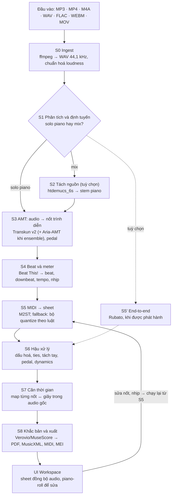
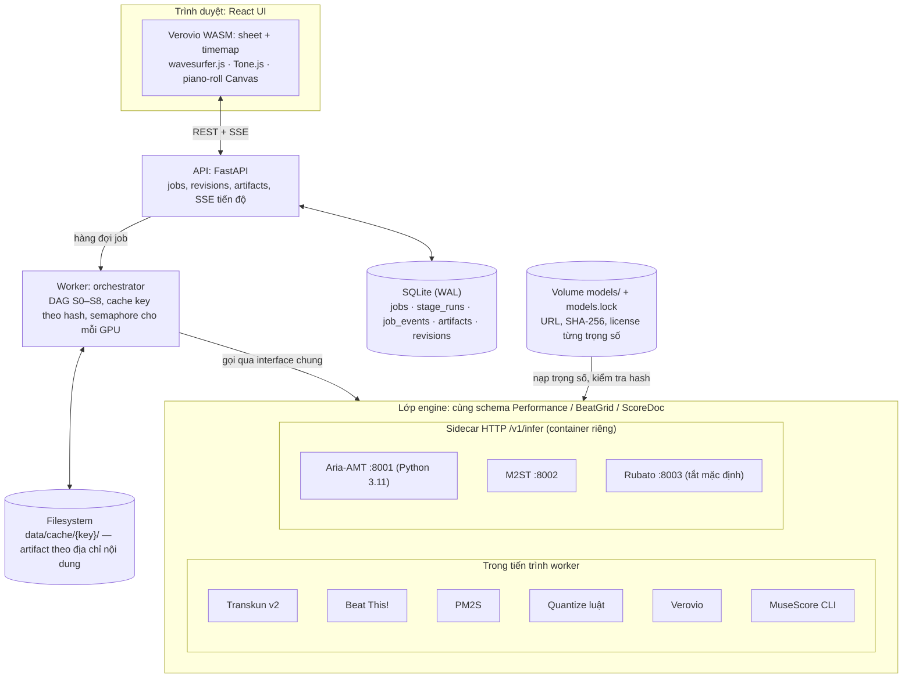

# P2S Local — Ứng dụng chuyển nhạc piano (MP3/MP4) thành sheet nhạc, chạy local

> [English](p2s-spec.md) · **Tiếng Việt**

> Cập nhật: 2026-10-20. Bản xuất từ Claude Doc "P2S Local — Piano audio/video → Sheet nhạc (chạy local)"; các sơ đồ đã đổi sang mermaid/bảng.
> Các mã quyết định dạng `D-xxx` là tham chiếu ổn định để tra cứu; nhật ký quyết định được lưu riêng và không công bố ở đây.

## Tóm tắt

Khuyến nghị: xây P2S Local theo kiến trúc **cascade có engine thay thế được** — Transkun v2 (audio→MIDI) → Beat This! (beat/downbeat) → M2ST (MIDI→MusicXML) → hậu xử lý → Verovio — chạy offline hoàn toàn trên GPU on-prem, và chừa sẵn slot cho mô hình end-to-end Rubato khi được phát hành.

- **Vì sao cascade này:** trên tập ATEPP (1.495 bản ghi thật, chưa mô hình nào thấy khi train), Transkun→M2ST là cascade mở tốt nhất với OMR-NED 85,2 (thấp hơn = tốt hơn). Rubato end-to-end đạt 75,9; Gemini 3.1 Pro (zero-shot) chỉ đạt ~98,6 trên ASAP.
- **Điểm nghẽn thật nằm ở MIDI→score, không ở bước nghe nốt:** Transkun đã đạt note F1 98,3 trên MAESTRO, và đưa MIDI chuẩn (oracle) vào cascade gần như không cải thiện OMR-NED. Vì vậy công sức tối ưu dồn vào bước quantize, tách tay, beat/downbeat và UI sửa lỗi.
- **Mục tiêu benchmark v1:** OMR-NED trên ATEPP ≤ 86, onset F1 trên MAESTRO ≥ 97,5, thắng ≥ 50% trong so sánh mù (ABX) với Songscription và Piano2Notes trên tập thực tế nội bộ.
- **UI:** web app local (FastAPI + React) — upload MP3/MP4, xem sheet đồng bộ với audio, sửa nốt trên piano-roll rồi dựng lại sheet, xuất PDF/MusicXML/MIDI.
- **Timeline:** 12 tuần, 2 kỹ sư (1 ML/audio, 1 full-stack); MVP chạy end-to-end ở tuần 6, báo cáo benchmark đầy đủ ở tuần 10.

## 1. Ứng dụng thương mại hiện có

Các công cụ cho kết quả tốt nhất hiện nay đều chạy trên cloud; AnthemScore là lựa chọn offline duy nhất đáng kể nhưng dùng mô hình đời cũ. Không vendor nào công bố benchmark có kiểm soát — chính Songscription ghi rõ bài so sánh của họ không phải benchmark độ chính xác có kiểm soát. Đây là khoảng trống cho một app local dùng mô hình mở SOTA.

| Ứng dụng | Triển khai | Đầu vào → đầu ra | Mô hình giá | Điểm mạnh | Hạn chế | Test độc lập (sspai, 9 công cụ, audio piano tách từ bài hát) |
| --- | --- | --- | --- | --- | --- | --- |
| [Songscription](https://www.songscription.ai/blog/best-ai-piano-transcription-software) | Web, cloud | File audio, link YouTube, mic → PDF, MIDI, MusicXML, Guitar Pro | Free: không giới hạn clip 30 giây; trả phí theo gói | Tập trung piano, có piano-roll editor để sửa trước khi xuất | Cần internet; dữ liệu rời máy | Nhóm tốt nhất |
| [AnthemScore](https://www.songscription.ai/blog/songscription-vs-anthemscore) (Lunaverus) | Desktop Win/Mac/Linux, offline | Audio → MusicXML, MIDI, PDF | Mua một lần; trial 30 ngày giới hạn độ dài | Chạy offline; sửa trên spectrogram | Mô hình cũ hơn các model cloud mới; kém với mix dày | Nhóm tốt nhất |
| [Klangio Piano2Notes](https://apps.appfollow.io/ios/piano2notes/1589420929?country=ru) | Web + iOS/Android, cloud; có API cho dev | MP3/mic → MIDI, PDF, MusicXML | Freemium/subscription | Chuyên piano đa âm; hệ sinh thái Transcription Studio, plugin DAW | Bắt buộc có mạng; không tách được nhiều nhạc cụ; tự nhận không bắt được 100% nốt | Nhóm khá |
| Ivory (Piano-to-Notes AI) | App, cloud | Audio piano → sheet | Trả phí | — | — | Nhóm khá |
| [La Touche Musicale PianoConvert](https://latouchemusicale.crunch.help/en/conversion-apps/quelle-app-choisir-selon-votre-objectif-piano-guitare-sax-voix) | Web, cloud | Audio → sheet/MIDI/MusicXML | Subscription | Có app riêng cho từng nhạc cụ | Kết quả kém trên piano tách từ bài hát | Nhóm kém |
| ScoreCloud, Melody Scanner, Logic Pro (audio→MIDI) | Desktop/app | Audio → notation/MIDI | Khác nhau | Ghi âm nhanh giai điệu | Không hợp với piano đa âm | Nhóm kém |
| MuseScore Studio 4 | Desktop, offline | Chỉ là trình soạn/khắc bản | Miễn phí | Engraving đẹp, import MusicXML/MIDI | Không tự chép nhạc từ audio | — (dùng làm trình xem/sửa đầu ra) |

Bài test độc lập trên [sspai](https://sspai.com/post/103825) dùng audio piano chất lượng thấp tách từ bài hát pop, nên kết quả phản ánh đúng kịch bản "bài hát có piano đệm". Các vendor đều thừa nhận chất lượng phụ thuộc vào bản ghi hơn là vào công cụ, và tách stem trước giúp tăng độ chính xác rõ rệt ([nguồn](https://www.songscription.ai/blog/best-mp3-to-sheet-music-converters)).

## 2. Nghiên cứu và mô hình mở (SOTA đến 10/2026)

Bài toán gồm hai nửa có độ khó rất khác nhau. Audio → performance MIDI gần như đã bão hoà (note F1 97–98% trên MAESTRO); performance MIDI → sheet (ô nhịp, giá trị nốt, tách tay, dấu hoá) vẫn sai nhiều. Mô hình end-to-end Rubato (5/2026) cho thấy chính biểu diễn trung gian MIDI là trần của cách làm cascade.

### 2.1 Audio → performance MIDI (AMT)

| Engine | Kiến trúc | Note F1 MAESTRO | Note+velocity F1 | Cài đặt / license | Vai trò trong P2S |
| --- | --- | --- | --- | --- | --- |
| [Transkun v2](https://pypi.org/project/transkun/2.0.0) | Transformer chấm điểm khoảng thời gian + semi-CRF | 98,3 | 97,9 | `pip install transkun`; MIT | Engine mặc định |
| [Aria-AMT](https://github.com/EleutherAI/aria-amt) (EleutherAI) | Seq2seq kiểu Whisper | 97,6 | 96,4 | Python 3.11; hỗ trợ int8 + `torch.compile`; kiểm tra license | Engine thứ hai cho bản thu "ngoài đời" (YouTube, điện thoại); ensemble |
| [ByteDance high-res](https://github.com/AK391/piano_transcription) (Kong et al.) | CRNN hồi quy onset/offset, có model pedal | 96,8 | 95,0 | `pip install piano_transcription_inference` | Nguồn pedal dự phòng |
| MT3 (Google) | T5 đa nhạc cụ | 95,7 | — | kiểm tra license | Chỉ dùng khi bài có nhiều nhạc cụ |
| [hFT-Transformer](https://github.com/sony/hFT-Transformer) (Sony) | Transformer phân cấp tần số–thời gian | SOTA tại ISMIR 2023 | — | Có checkpoint công khai | Tuỳ chọn, để so sánh |

Số liệu F1 lấy từ bảng so sánh trong [paper Rubato](https://arxiv.org/html/2605.24291v1) (MAESTRO test, 177 file, dung sai onset 50 ms). Lưu ý độ bền: [Edwards et al.](https://arxiv.org/pdf/2402.01424) chỉ ra các mô hình overfit đặc tính âm học của MAESTRO, nên benchmark của P2S phải có tập ngoài phân phối (điện thoại, đàn upright, YouTube).

### 2.2 Beat, downbeat, ô nhịp

- [Beat This!](https://huggingface.co/schism-audio/beat-this-mlx) (CPJKU, ISMIR 2024, MIT): transformer trên log-mel 50 fps, không cần hậu xử lý DBN. Trên ASAP đạt beat F1 79,9 và downbeat F1 64,9. Có bản small 2,1M tham số và bản ONNX.
- Downbeat là khâu yếu nhất: cho Piano-A2S dùng downbeat chuẩn thì OMR-NED giảm 8,8 điểm (86,6 → 77,8). Hệ quả cho thiết kế: UI phải cho người dùng chỉnh tempo, nhịp và ô nhịp đầu tiên.

### 2.3 Performance MIDI → sheet

- **PM2S** (Liu et al., 2022): CRNN với các head riêng cho beat, key, time signature, giá trị nốt và khuông (tay). Giữ được nét trình diễn nhưng sheet thiếu mạch lạc dài hạn.
- **[M2ST](https://arxiv.org/html/2410.00210v1)** (Beyer & Dai, ISMIR 2024): seq2seq RoFormer xuất thẳng token MusicXML, đoán cả trill và hướng đuôi nốt; code và model trên GitHub. Train trên kho MuseScore đóng nên khó tái huấn luyện.
- **Piano-A2S** (Zeng et al., IJCAI 2024): audio → \*\*kern theo khối 5 ô nhịp, cần vị trí downbeat đầu vào.
- **MuseScore MIDI import**: quantize theo luật, dùng làm baseline thấp.

### 2.4 End-to-end: Rubato (UW + AI2, 5/2026, NeurIPS 2026)

- Fast Conformer encoder + Transformer decoder (~180M tham số, kiến trúc Canary-180M-Flash). Xuất InterMo: chuỗi text gồm "interval" (thời lượng theo nhịp) và "moment" (nhấn/nhả phím) kèm timestamp, nên sheet căn sẵn theo audio.
- Dữ liệu: MAESTRO (159 giờ), (n)ASAP (30 giờ), PDMX tổng hợp (2.071 giờ, 8 VST piano × 2 cấu hình phòng).
- Tốc độ: ~21× real-time cho chế độ sheet trên một L40S (beam 4), decode cửa sổ 40 giây, hop 50%.
- Trạng thái: [tác giả hứa phát hành model và code khi công bố](https://neurips.cc/virtual/2026/poster/149838); license model chưa rõ. P2S coi Rubato là plugin tuỳ chọn, không phụ thuộc vào nó.

### 2.5 Tách nguồn (bài hát có piano lẫn nhạc cụ khác)

- **htdemucs_6s** (Meta): 6 stem có piano, ~105 MB, trọng số MIT theo [mlx-audio-separator](https://huggingface.co/ssmall256/mlx-audio-separator).
- **BS-RoFormer-SW**: 6 stem có piano, ~667 MB, license trọng số chưa rõ — chỉ dùng nội bộ cho tới khi xác minh.

### 2.6 Điểm chuẩn đã công bố (OMR-NED trên ATEPP-filtered)

Nguồn: bảng 2, paper Rubato (arXiv 2605.24291). ATEPP-filtered, n = 1.495 bản ghi. OMR-NED thấp hơn = ít công sửa hơn.

| Hệ thống | OMR-NED ↓ (± 95% CI) | Số bản không ra output |
| --- | --- | --- |
| Rubato (end-to-end) | 75,9 ± 0,9 | 0 |
| **Transkun → M2ST (mặc định P2S v1)** | **85,2 ± 0,5** | 1 |
| Aria-AMT → M2ST | 85,6 ± 0,4 | 0 |
| ByteDance → M2ST | 86,5 ± 0,4 | 0 |
| MT3 → M2ST | 88,8 ± 0,3 | 0 |
| Beat This! → Piano-A2S | 88,9 ± 0,3 | 0 |
| Transkun → PM2S | 92,0 ± 0,2 | 8 |
| ByteDance → PM2S | 92,5 ± 0,2 | 1 |
| Aria-AMT → PM2S | 93,2 ± 0,2 | 3 |
| MT3 → PM2S | 93,3 ± 0,2 | 135 |

Mục tiêu P2S: v1 ≤ 86, v2 ≤ 80 (xem mục 6.5).

Trên ASAP, thay MIDI dự đoán bằng MIDI chuẩn không làm OMR-NED của cascade tốt lên, nên khoảng cách này chủ yếu đến từ bước MIDI → sheet. Gemini 3.1 Pro zero-shot đạt khoảng 98,6 trên ASAP (khác tập nên không có trong bảng), tức LLM đa năng chưa dùng được cho việc này.

## 3. Pipeline đề xuất

Pipeline gồm 9 stage, mỗi stage là một interface có engine thay được; mặc định là cascade Transkun → Beat This! → M2ST, có nhánh tách nguồn khi audio là bài hát, và nhánh end-to-end Rubato khi model có sẵn. Mọi output trung gian được cache theo hash, nên khi người dùng sửa nốt hay nhịp thì chỉ chạy lại từ stage bị ảnh hưởng.



Nét đứt là nhánh chỉ chạy khi cần: tách nguồn khi S1 phát hiện bài hát có nhạc cụ khác, và Rubato thay cả S3–S5 khi có trọng số.

| Stage | Vào → ra | Engine mặc định | Phương án thay thế | Ghi chú thiết kế |
| --- | --- | --- | --- | --- |
| S0 Ingest | MP3/MP4/M4A/WAV/FLAC/WEBM/MOV → WAV 44,1 kHz stereo | ffmpeg | — | Chuẩn hoá loudness EBU R128; cắt đoạn start/end; SHA-256 nội dung làm cache key |
| S1 Phân tích & định tuyến | WAV → nhãn {solo piano, mix} + cảnh báo chất lượng | Tỉ lệ năng lượng stem piano / tổng (htdemucs_6s chạy nhanh) | Audio tagger | Ngưỡng mặc định 0,8, chỉnh trong config; cảnh báo clipping, sample rate thấp, im lặng dài |
| S2 Tách nguồn (tuỳ chọn) | Mix → stem piano | htdemucs_6s | BS-RoFormer-SW (nội bộ) | Chỉ chạy khi S1 báo mix hoặc người dùng bật |
| S3 AMT | Audio → performance notes (pitch, onset, offset, velocity) + pedal CC64 | Transkun v2 | Aria-AMT, ByteDance; ensemble Transkun + Aria | Ensemble: ghép nốt theo pitch, dung sai onset 50 ms; nốt chỉ một engine thấy được giữ theo luật bỏ phiếu cấu hình được |
| S4 Beat & meter | Audio → beats, downbeats, đường tempo, time signature | Beat This! final0 | Beat This! small (CPU) | Time signature suy từ số beat giữa hai downbeat; gợi ý của người dùng (BPM, nhịp) được ưu tiên |
| S5 MIDI → score | Notes + beats → MusicXML (2 khuông) | M2ST | PM2S; bộ quantize theo luật (lưới beat + quy hoạch động) | Bộ quantize luật là fallback luôn chạy được, không cần GPU |
| S5′ End-to-end | Audio → MusicXML có timestamp | — | Rubato (khi phát hành) | Thay cho S3–S5; vẫn qua S6–S8 |
| S6 Hậu xử lý | MusicXML → MusicXML sạch | Bộ luật nội bộ (music21/partitura) | — | Dấu hoá theo key, gộp dấu lặng, ties qua vạch nhịp, clef/ottava, pedal từ CC64, dynamics từ phân vị velocity, kiểm tra tổng trường độ mỗi ô nhịp |
| S7 Căn thời gian | Score + performance → map `note_id ↔ (onset_s, offset_s)` | Căn DTW performance–score | Timestamp từ Rubato | Dùng để highlight nốt khi phát audio |
| S8 Khắc bản & xuất | MusicXML → SVG, PDF, MIDI, MEI | Verovio | MuseScore 4 CLI cho PDF đẹp hơn | Xuất cả MIDI trình diễn lẫn MIDI đã quantize |

**Ba preset cho người dùng:**

1. **Chính xác (GPU):** ensemble Transkun + Aria-AMT, M2ST, PDF qua MuseScore.
2. **Nhanh (CPU):** Transkun trên CPU, Beat This! small, bộ quantize luật.
3. **Bài hát có lời/ban nhạc:** như preset 1 nhưng bật S2 tách nguồn.

## 4. Spec sản phẩm

P2S Local v1 nhận một file audio/video có piano, trả về sheet 2 khuông đọc được, đồng bộ với audio, sửa được và xuất ra PDF/MusicXML/MIDI — tất cả chạy trên máy cá nhân hoặc server on-prem, không gửi dữ liệu ra ngoài. Người dùng mục tiêu: người học piano, giáo viên, người soạn hoà âm, và team nội bộ cần chép hàng loạt.

### 4.1 Yêu cầu chức năng

| ID | Yêu cầu | Ưu tiên | Tiêu chí chấp nhận |
| --- | --- | --- | --- |
| FR-01 | Upload MP3, MP4, M4A, WAV, FLAC, WEBM, MOV | P0 | File ≤ 500 MB và ≤ 20 phút decode được; file hỏng báo lỗi rõ ràng, không treo job |
| FR-02 | Chọn đoạn start/end trên waveform trước khi chạy | P1 | Chỉ đoạn đã chọn được xử lý; timestamp trong output tính theo file gốc |
| FR-03 | Chọn preset; tuỳ chỉnh engine AMT, tách nguồn, gợi ý BPM/nhịp/key, lưới quantize (1/8, 1/16, 1/32, triplet), pedal, dynamics | P0 preset, P1 tuỳ chỉnh | Mọi tham số lưu vào manifest của job |
| FR-04 | Tiến độ từng stage theo thời gian thực; huỷ job | P0 | Cập nhật qua SSE ≤ 1 giây/lần; huỷ giải phóng GPU trong ≤ 5 giây |
| FR-05 | Hiển thị sheet 2 khuông | P0 | Render bằng Verovio; zoom, chuyển trang |
| FR-06 | Phát audio gốc đồng bộ với sheet | P0 | Highlight ô nhịp/nốt đang phát; click ô nhịp để nhảy tới thời điểm đó |
| FR-07 | Phát sheet bằng tiếng piano tổng hợp, chuyển A/B với audio gốc | P1 | Chuyển không mất vị trí phát |
| FR-08 | Piano-roll: thêm/xoá/kéo nốt, sửa velocity, sửa beat/downbeat, rồi "Dựng lại sheet" | P0 nốt, P1 beat | Chỉ chạy lại S5–S8; thời gian dựng lại bản 3 phút ≤ 15 giây trên GPU |
| FR-09 | Chỉnh nhanh trên sheet: đổi key/nhịp, chuyển nốt sang khuông kia, transpose | P2 | Thay đổi xuất ra được MusicXML |
| FR-10 | Xuất PDF, MusicXML (.mxl), MIDI (trình diễn + đã quantize), MEI, stem piano | P0 PDF/MusicXML/MIDI, P1 còn lại | File mở được trong MuseScore 4 không lỗi |
| FR-11 | Lịch sử job: đặt tên, tìm, xoá | P0 | Dữ liệu chỉ nằm trong thư mục data local |
| FR-12 | CLI chạy batch | P0 | `p2s transcribe in.mp4 -o out/ --preset accurate` cho kết quả giống UI |
| FR-13 | REST API local | P0 | Đặc tả OpenAPI sinh tự động |
| FR-14 | Trang Engines: phiên bản, license, hash trọng số, trạng thái GPU | P1 | Cảnh báo khi trọng số có license hạn chế |
| FR-15 | Giao diện tiếng Việt và tiếng Anh | P1 | Đổi ngôn ngữ không cần reload |

### 4.2 Yêu cầu phi chức năng

| ID | Thuộc tính | Mục tiêu |
| --- | --- | --- |
| NFR-01 | Offline | Sau lần tải trọng số đầu tiên, không có request ra ngoài; chế độ air-gapped nạp trọng số từ thư mục |
| NFR-02 | Tốc độ | Bản 3 phút, preset Chính xác, ≤ 60 giây trên 1 GPU lớp RTX 4090/L40S; preset Nhanh ≤ 5 phút trên CPU 8 nhân (mục tiêu, đo ở Phase 3) |
| NFR-03 | Bộ nhớ | VRAM đỉnh ≤ 12 GB (engine chạy tuần tự, unload sau khi dùng); RAM ≤ 16 GB |
| NFR-04 | Độ bền | Nếu S3 thành công thì job luôn có sheet: M2ST lỗi/timeout → fallback bộ quantize luật; tỉ lệ job không có output = 0 trên tập benchmark |
| NFR-05 | Tái lập | Cùng input + config + phiên bản engine → output giống hệt byte; mỗi output kèm manifest (phiên bản, hash trọng số, config) |
| NFR-06 | Riêng tư | Tuỳ chọn tự xoá job sau N ngày; không telemetry |
| NFR-07 | Mở rộng | Thêm engine = một class + một mục config, không sửa core |
| NFR-08 | Nền tảng | Linux + NVIDIA CUDA 12.x là chính; macOS Apple Silicon và Windows (WSL2) ở mức chạy được |

### 4.3 Ngoài phạm vi v1

- Chép real-time khi đang chơi; nhạc cụ khác piano (chỉ tách để lấy piano).
- Ngón bấm (fingering), bản giản lược cho người mới, OMR từ ảnh sheet.
- Chép từ hình ảnh bàn phím trong video — để dành cho v3.
- Tải audio từ YouTube: không bật mặc định vì vấn đề bản quyền và điều khoản dịch vụ.

## 5. Design hệ thống

Kiến trúc tách ba lớp: UI web chạy trong trình duyệt, API + orchestrator Python, và một lớp engine trừu tượng gồm engine chạy trong tiến trình và engine "sidecar" chạy container riêng qua HTTP. Lớp engine là điểm mấu chốt: mỗi mô hình có phụ thuộc riêng (Aria-AMT cần Python 3.11, M2ST ghim phiên bản torch riêng), nên cô lập chúng thì nâng cấp hay thay mô hình mà không đụng core.



Worker chỉ biết interface; đổi Aria-AMT, M2ST hay bật Rubato là đổi một mục trong `configs/engines.yaml`, không sửa code core.

### 5.1 Tech stack

| Lớp | Lựa chọn | Lý do |
| --- | --- | --- |
| Frontend | React 18 + TypeScript + Vite, TanStack Query, Zustand, i18next | Phổ biến, dễ tuyển, hot reload nhanh |
| Render sheet | Verovio (WASM, LGPL-3.0) + `renderToTimemap` | Render MusicXML/MEI ra SVG và cho bản đồ thời gian để highlight khi phát |
| Audio trên UI | wavesurfer.js v7 (waveform, chọn đoạn, marker beat), Tone.js + bộ sample piano (phát sheet tổng hợp) | Chạy hoàn toàn trong trình duyệt |
| Piano-roll | Canvas tự viết (hoặc PixiJS nếu > 10.000 nốt) | Cần sửa nốt mượt với bản dài |
| API | Python 3.11 (uv), FastAPI, Pydantic v2, sse-starlette | Cùng ngôn ngữ với engine ML; OpenAPI tự sinh |
| Lưu trữ | SQLite (WAL) qua SQLModel + filesystem cho artifact | Không cần dịch vụ ngoài khi chạy local |
| Hàng đợi | Bảng `jobs` trong SQLite, worker giành job bằng `UPDATE … RETURNING` | Đủ cho 1 người dùng; interface `JobQueue` cho phép đổi sang Redis/Postgres khi chạy server nhiều người |
| Xử lý nhạc | ffmpeg, PyTorch 2.x + CUDA 12, music21, partitura, Verovio Python, MuseScore 4 headless (PDF) | Thư viện chuẩn trong cộng đồng MIR |
| Đóng gói | Docker Compose (GPU qua NVIDIA Container Toolkit); cài trực tiếp bằng `uv tool install` cho dev | Một lệnh khởi động trên server on-prem |

### 5.2 Interface engine

Mọi engine trả về cùng một schema Pydantic, nên orchestrator, cache và benchmark không cần biết engine bên dưới là gì.

```python
class NoteEvent(BaseModel):
    pitch: int              # MIDI 21–108
    onset: float            # giây, theo file gốc
    offset: float
    velocity: int           # 1–127
    confidence: float | None = None

class Performance(BaseModel):
    notes: list[NoteEvent]
    pedals: list[tuple[float, float]]   # sustain CC64 (on, off)
    engine: EngineInfo                  # id, version, weights_sha256, license, device

class BeatGrid(BaseModel):
    beats: list[float]
    downbeats: list[float]
    time_signatures: list[tuple[float, str]]   # (thời điểm, "3/4")
    tempo_bpm: list[tuple[float, float]]

class ScoreDoc(BaseModel):
    musicxml: bytes
    alignment: dict[str, tuple[float, float]] | None   # note_id → (onset, offset)
    key: str | None
    warnings: list[str]                                 # ô nhịp nghi ngờ, fallback đã dùng

class Separator(Protocol):        # S2
    def separate(self, audio: AudioRef, stem: Literal["piano"]) -> AudioRef: ...
class Transcriber(Protocol):      # S3
    def transcribe(self, audio: AudioRef, opts: AMTOptions) -> Performance: ...
class BeatTracker(Protocol):      # S4
    def track(self, audio: AudioRef, hints: MeterHints) -> BeatGrid: ...
class ScoreBuilder(Protocol):     # S5
    def build(self, perf: Performance, grid: BeatGrid, opts: ScoreOptions) -> ScoreDoc: ...
class EndToEnd(Protocol):         # S5′
    def transcribe_score(self, audio: AudioRef, opts: ScoreOptions) -> ScoreDoc: ...
```

Engine và preset khai báo trong YAML (`configs/engines.yaml`, `configs/presets.yaml`); thêm engine mới chỉ cần một class và một mục config.

**Hợp đồng sidecar:** `GET /v1/info` (EngineInfo + thiết bị), `GET /v1/health`, `POST /v1/infer` (multipart audio hoặc JSON `Performance` + options → JSON cùng schema). Sidecar có thể chạy trên node GPU khác trong mạng nội bộ chỉ bằng cách đổi `url`.

### 5.3 Dữ liệu, cache và chạy lại

- **Bảng SQLite:** `jobs` (id ULID, tên, trạng thái, preset, params, input_sha256), `stage_runs` (stage, engine, cache_key, thời gian, VRAM đỉnh, RTF), `artifacts` (loại, đường dẫn, sha256), `revisions` (bản vá nốt/beat của người dùng, liên kết artifact gốc), `job_events` (log tiến độ cho SSE).
- **Cache key** = SHA-256 của (input_sha256, stage, engine_id, engine_version, weights_sha256, params của stage, cache key của stage trước). Artifact lưu theo địa chỉ nội dung trong `data/cache/<key>/`, nên upload lại cùng file hay đổi tham số ở S5 đều tái dùng S0–S4.
- **Chạy lại khi sửa:** mỗi lần "Dựng lại sheet" tạo một revision mới; orchestrator duyệt DAG và chỉ chạy các stage có cache key thay đổi.
- **Lập lịch GPU:** một semaphore cho mỗi GPU; engine nạp lười và unload sau khi stage xong để giữ VRAM đỉnh ≤ 12 GB. Stage CPU (S0, S6, S8) chạy song song.
- **Manifest:** mỗi job xuất `manifest.json` gồm phiên bản P2S, engine, hash trọng số, config — điều kiện cho NFR-05 và cho benchmark.

### 5.4 REST API (local, prefix `/api/v1`)

| Method | Path | Mô tả |
| --- | --- | --- |
| POST | `/jobs` | Multipart: `file`, `preset`, `params` (JSON), `range` → `{job_id}` |
| GET | `/jobs` | Danh sách job, phân trang bằng cursor |
| GET | `/jobs/{id}` | Trạng thái, các stage, artifact, cảnh báo |
| GET | `/jobs/{id}/events` | Luồng SSE tiến độ từng stage |
| POST | `/jobs/{id}/cancel` | Huỷ job, giải phóng GPU |
| DELETE | `/jobs/{id}` | Xoá job và artifact không còn được tham chiếu |
| GET | `/jobs/{id}/artifacts/{kind}` | Tải `pdf`, `mxl`, `mid`, `mid_quantized`, `mei`, `svg`, `timemap`, `stem_piano`, `manifest` |
| POST | `/jobs/{id}/revisions` | Body: bản vá nốt/beat + `score_options` → chạy lại từ S5 → `{revision_id}` |
| GET | `/engines` | Engine, phiên bản, license, trạng thái sức khoẻ |
| POST | `/engines/{id}/weights` | Tải trọng số (chỉ khi đang online) hoặc nạp từ thư mục |

### 5.5 Thiết kế UI

Màn hình chính là **Workspace**: sheet ở giữa, transport và waveform ở dưới, piano-roll là ngăn kéo lên được, panel phải hiện cảnh báo theo ô nhịp. Mọi thao tác sửa đều dẫn về một nút "Dựng lại sheet" duy nhất.

```text
┌───────────────────────────────────────────────────────────────────────┐
│ Tên bản nhạc · preset Chính xác             [Dựng lại sheet] [Xuất ▾] │
├───────────────────────────────────────────────┬───────────────────────┤
│ Sheet (Verovio) · click ô nhịp để nhảy tới    │ Thông tin             │
│ thời điểm đó                                  │   Key · nhịp · tempo  │
│                                               │ Cảnh báo              │
│   [ô nhịp đang phát được tô nền]              │   Sai tổng trường độ  │
│                                               │   Mật độ nốt bất thường│
│                                               │   Đã dùng fallback    │
│                                               │ Engine đã dùng        │
│                                               │   Transkun v2 · M2ST  │
├───────────────────────────────────────────────┴───────────────────────┤
│ ▶ Phát   Tốc độ 0,5–1,0×   Loop A–B   Audio gốc ↔ Piano tổng hợp      │
├───────────────────────────────────────────────────────────────────────┤
│ Waveform · marker beat/downbeat kéo được                              │
├───────────────────────────────────────────────────────────────────────┤
│ Piano-roll (ngăn kéo lên) · nốt tô màu theo tay phải / tay trái       │
└───────────────────────────────────────────────────────────────────────┘
```

Sửa nốt trên piano-roll hay kéo marker beat đều chỉ đánh dấu bản nháp; sheet chỉ đổi khi bấm "Dựng lại sheet", nên người dùng gom nhiều sửa đổi vào một lần chạy lại.

| Màn hình | Nội dung chính |
| --- | --- |
| Thư viện | Danh sách job: tên, thời lượng, preset, trạng thái, ảnh trang 1; tìm kiếm, xoá |
| Tạo job | Kéo-thả file; waveform để chọn đoạn; chọn preset; panel nâng cao (BPM, nhịp, key, lưới quantize, tách nguồn) |
| Đang xử lý | Thanh tiến độ S0–S8, ETA, log rút gọn, nút huỷ; sheet hiện dần khi S8 xong từng trang |
| Workspace | Sheet Verovio có highlight theo audio; click ô nhịp để nhảy; transport (tốc độ 0,5–1,0×, loop A–B, chuyển audio gốc ↔ piano tổng hợp); waveform có marker beat/downbeat kéo được; piano-roll tô màu theo tay; panel cảnh báo (ô nhịp sai tổng trường độ, mật độ nốt bất thường, fallback đã dùng) |
| Engines & Cài đặt | GPU, engine, license, hash trọng số, thư mục data, tự xoá sau N ngày, ngôn ngữ |
| Benchmark viewer (nội bộ) | Bảng kết quả và so sánh hai hệ thống cạnh nhau trên cùng một bài, dùng cho đánh giá mù |

### 5.6 Cấu trúc repo

```text
p2s/
├── apps/web/                    # React + Vite UI
├── p2s/                         # package Python
│   ├── api/                     # router FastAPI, SSE
│   ├── core/                    # schema, DAG pipeline, cache, manifest
│   ├── engines/                 # transkun.py, beat_this.py, pm2s.py, rulequant.py, sidecar_client.py
│   ├── post/                    # làm sạch MusicXML, dấu hoá, tách tay, dynamics
│   ├── render/                  # verovio, musescore, timemap
│   ├── worker/                  # hàng đợi, lập lịch GPU
│   └── cli.py
├── sidecars/{aria_amt,m2st,rubato}/   # Dockerfile + server.py cho mỗi engine
├── bench/                       # datasets/, systems/, metrics/, reports/
├── configs/{engines.yaml,presets.yaml,models.lock}
├── docker-compose.yml
└── tests/{unit,golden,contract,e2e}
```

### 5.7 Triển khai

- **Docker Compose:** `web` (nginx phục vụ UI tĩnh), `api`, `worker` (GPU), `aria-amt` và `m2st` (sidecar GPU), `rubato` (tắt mặc định). Volume `models/` giữ trọng số; `models.lock` ghi URL, SHA-256 và license từng file.
- **Chế độ dev/1 máy:** `uv tool install p2s && p2s serve` chạy API + worker + UI tĩnh trong một tiến trình, engine sidecar tự tắt nếu không có Docker.
- **Air-gapped:** `p2s weights import /path/to/bundle` nạp trọng số đã tải trước; khi khởi động, kiểm tra hash khớp `models.lock`.
- **Desktop (v2):** bọc bằng Tauri nếu cần app một-click cho người dùng không kỹ thuật.

### 5.8 Kiểm thử

- **Unit:** schema, cache key, hậu xử lý MusicXML (tổng trường độ, ties, dấu hoá).
- **Golden:** 10 clip ngắn → snapshot MusicXML; cùng phiên bản engine thì so khớp byte, khi nâng engine thì so bằng OMR-NED với ngưỡng cho phép.
- **Contract:** mọi engine (kể cả sidecar) qua cùng bộ test schema, khoảng thời gian, hành vi khi audio rỗng/im lặng.
- **E2E:** Playwright chạy luồng upload → xử lý → sửa nốt → dựng lại → xuất PDF.
- **Hiệu năng:** đo RTF và VRAM đỉnh trên runner GPU on-prem mỗi lần merge vào nhánh chính.

## 6. Benchmark so với SOTA

Benchmark đo 5 tầng (nốt → nhịp → sheet → nghe lại → người dùng) trên 5 bộ dữ liệu và 5 nhóm đối thủ. Hai chỉ số quyết định go/no-go là **OMR-NED trên ATEPP-filtered** (công sức sửa sheet) và **tỉ lệ thắng ABX** của người chơi piano trên tập thực tế nội bộ.

### 6.1 Tầng đánh giá và metric

| Tầng | Câu hỏi | Metric | Công cụ |
| --- | --- | --- | --- |
| L1 Nốt | Nghe đúng nốt không? | Onset F1 (50 ms), onset+offset F1, +velocity F1, pedal F1 | mir_eval, `transkunEval` |
| L2 Nhịp | Vạch nhịp đặt đúng không? | Beat F1, downbeat F1 (dung sai 70 ms) | mir_eval.beat |
| L3 Sheet | Sheet khác bản gốc bao nhiêu? | **OMR-NED** (chính), MUSTER (MeanER + lỗi pitch, thiếu, thừa, onset, offset, voice, tay), MV2H bản không cần căn | [VeroSim](https://github.com/btrkeks/verosim) (OMR-NED, parser Verovio), công cụ MUSTER, [MV2H](https://arxiv.org/pdf/1906.00566) |
| L4 Nghe lại | Phát sheet lên có giống bản ghi? | Render sheet → audio (FluidSynth + soundfont piano), so với gốc bằng chroma-DTW và độ tương đồng embedding CLaMP 3 | Theo khung [dual evaluation](https://www.alphaxiv.org/abs/2608.04511) (8/2026) |
| L5 Người dùng | Pianist có muốn dùng? | Tỉ lệ thắng ABX (mô hình Bradley–Terry), số phút sửa thành bản đúng trong MuseScore trên mỗi phút nhạc, điểm dễ đọc 1–5 | Benchmark viewer |
| Hệ thống | Có chạy nổi local? | Thời gian đầu-cuối, RTF, VRAM/RAM đỉnh, số job không ra output | Bảng `stage_runs` |

### 6.2 Bộ dữ liệu

| Bộ | Nội dung | Dùng cho | Lưu ý |
| --- | --- | --- | --- |
| MAESTRO v3 test | 177 bản Disklavier, căn MIDI ~3 ms | L1 | So trực tiếp với số đã công bố |
| MAPS ENSTDkCl/Am | Piano thật, phòng thu khác MAESTRO | L1 ngoài phân phối | Bắt lỗi overfit âm học |
| ASAP test (102) + ASAP-Beyer (25) | Audio + score + beat | L2, L3 | Nhiễm dữ liệu: M2ST đã train trên 98/102 bản; chỉ báo cáo kèm cờ |
| ATEPP-filtered | 1.495 bản ghi / 106 tác phẩm, bỏ bản có score từ ASAP | L3 chính, L4 | Tập công bằng nhất: chưa hệ nào train trên đó |
| P2S-Real (tự xây) | 60 clip 30–90 giây: 20 bản thu điện thoại (đàn upright/digital), 20 cover pop/nhạc Việt, 20 bài hát có piano lẫn giọng/ban nhạc | L3, L4, L5, so với app thương mại | Ground truth MusicXML do 2 người chơi piano kiểm tra chéo; chỉ dùng audio có quyền sử dụng |

### 6.3 Hệ thống so sánh

| Nhóm | Hệ thống | Cách chạy |
| --- | --- | --- |
| P2S | Preset Chính xác, preset Nhanh, các ablation (bỏ ensemble, PM2S thay M2ST, bỏ S6) | `p2s transcribe` batch |
| Cascade mở | Transkun→PM2S, Aria→M2ST, ByteDance→M2ST, Transkun→MuseScore import | Adapter trong `bench/systems` |
| End-to-end | Rubato (khi có trọng số) | Sidecar |
| Thương mại | Songscription, Klangio Piano2Notes, AnthemScore, PianoConvert | Upload thủ công hoặc qua API (Klangio có API dev), xuất MusicXML; ghi ngày, phiên bản, gói dịch vụ; chạy trên P2S-Real + 50 bản ATEPP lấy mẫu để giữ chi phí; tuân thủ điều khoản dịch vụ |
| LLM đa năng (tham chiếu) | Gemini 3.1 Pro zero-shot, như trong paper Rubato | Chỉ trong benchmark, không có trong app |

### 6.4 Giao thức

1. Mọi hệ nhận cùng một file: WAV 44,1 kHz đã chuẩn hoá loudness; app không nhận WAV thì dùng MP3 320 kbps và ghi lại.
2. Dùng cấu hình mặc định của từng hệ, không chỉnh tay output.
3. Hệ không trả output tính là thất bại; báo cáo cả trung bình trên bản thành công và số thất bại.
4. Trung bình theo bản ghi; khoảng tin cậy 95% bằng bootstrap 10.000 lần; so cặp bằng Wilcoxon signed-rank, hiệu chỉnh Holm.
5. Tách kết quả theo thể loại (cổ điển, pop, jazz) và điều kiện thu (studio, điện thoại, mix).
6. Đánh giá người: 5 người chơi piano trình độ khá trở lên, mỗi người 40 cặp ABX ngẫu nhiên, ẩn tên hệ; đo thời gian sửa trong MuseScore trên 10 bản.
7. Chống nhiễm: không fine-tune trên ATEPP hay P2S-Real; bảng phụ lục ghi bản nào đã nằm trong dữ liệu train của engine nào.
8. Tái lập: `p2s-bench run --suite atepp --system p2s:accurate` ghi Parquet, sinh báo cáo HTML kèm manifest của mọi hệ.

### 6.5 Mục tiêu

| Metric | Tập | Tham chiếu | v1 (tuần 10) | v2 |
| --- | --- | --- | --- | --- |
| Onset F1 | MAESTRO test | Bảng 2.1 | ≥ 97,5 | ≥ 98,0 |
| Onset F1 | MAPS | 88,4 ([Edwards et al.](https://arxiv.org/pdf/2402.01424), không train trên MAPS) | ≥ 85 | ≥ 88 |
| Downbeat F1 | ASAP | Mục 2.2 | ≥ 64 | ≥ 68 |
| OMR-NED ↓ | ATEPP-filtered | Bảng 2.6 | ≤ 86 | ≤ 80 |
| MUSTER MeanER ↓ | ASAP | Đo baseline Transkun→MuseScore import ở Phase 1 | Thấp hơn baseline ≥ 30% | Thấp hơn ≥ 45% |
| Tỉ lệ thắng ABX | P2S-Real | — | ≥ 50% so với Songscription và Piano2Notes | ≥ 60% |
| Phút sửa / phút nhạc | P2S-Real | App thương mại tốt nhất | ≤ 1,0× | ≤ 0,7× |
| Thời gian bản 3 phút | GPU lớp RTX 4090 | — | ≤ 60 giây | ≤ 30 giây |
| Job không ra output | Mọi tập | Tkun→PM2S hỏng 8 bản trên ATEPP | 0 | 0 |

### 6.6 Thiết kế bộ công cụ benchmark

- `bench/datasets`: mỗi adapter trả `(audio, gt_score, gt_midi, gt_beats, meta)`; tải và kiểm tra hash, không đóng gói dữ liệu có license hạn chế.
- `bench/systems`: adapter cho engine local, sidecar, và adapter "thư mục" đọc file MusicXML xuất từ app thương mại theo `manifest.csv`.
- `bench/metrics`: registry metric (mir_eval, VeroSim, MUSTER, MV2H, chroma-DTW, CLaMP 3); mọi metric nhận MusicXML/MIDI chuẩn hoá.
- Kết quả lưu Parquet, truy vấn bằng DuckDB; báo cáo HTML có bảng, khoảng tin cậy, và sheet so sánh cạnh nhau cho từng bản tệ nhất.

## 7. Kế hoạch triển khai

Kế hoạch 12 tuần, 5 gate; MVP có UI ở tuần 6, báo cáo benchmark v1 ở tuần 10, phát hành nội bộ v1.0 ở tuần 12. Nhân sự: 1 kỹ sư ML/audio (engine, S5–S6, benchmark), 1 kỹ sư full-stack (API, UI, triển khai), và 2–5 người chơi piano bán thời gian ở tuần 6–10 để soạn ground truth và chấm ABX. Phần cứng: 1 GPU 24 GB cho dev, server GPU on-prem cho benchmark.

| Phase | Tuần | Gate cuối phase |
| --- | --- | --- |
| P0 Spike | 1 | G0 spike xong |
| P1 Core pipeline + CLI | 2–4 | G1 CLI |
| P2 API + UI MVP | 4–6 | **G2 MVP** |
| P3 Benchmark đầy đủ | 6–10 | G3 benchmark v1 |
| P4 Chất lượng, công cụ sửa | 7–10 (song song P3) | Chung G3 |
| P5 Đóng gói, phát hành | 11–12 | G4 v1.0 |

P3 và P4 chạy song song: phân tích lỗi từ benchmark đổ thẳng vào việc cải thiện S5–S6 và công cụ sửa.

### Phase 0 — Spike (tuần 1)

- [ ] Dựng môi trường CUDA, chạy Transkun v2, Aria-AMT, Beat This!, PM2S, M2ST trên 20 bản ATEPP + 10 clip nội bộ
- [ ] Xác minh license code và trọng số từng engine, ghi vào `models.lock`
- [ ] Kiểm tra M2ST có xuất được map note ↔ thời gian không; nếu không, chốt cách căn DTW cho S7
- **Gate G0:** cả 5 engine chạy local; OMR-NED Transkun→M2ST trên 20 bản lệch ≤ 3 điểm so với số công bố

### Phase 1 — Core pipeline + CLI (tuần 2–4)

- [ ] Schema, DAG, cache theo nội dung, manifest
- [ ] Engine in-process (Transkun, Beat This!, PM2S) và sidecar (Aria-AMT, M2ST) theo hợp đồng `/v1/infer`
- [ ] Bộ quantize luật làm fallback; hậu xử lý S6; căn thời gian S7
- [ ] Xuất Verovio SVG/timemap, PDF qua MuseScore headless, MIDI, MusicXML, MEI
- [ ] Khung `bench/` với L1, L2 và OMR-NED; chạy baseline Transkun→MuseScore import
- **Gate G1:** `p2s transcribe` cho MusicXML/PDF mở được trong MuseScore với 100% của 50 bản ATEPP; số baseline đã ghi lại

### Phase 2 — API + UI MVP (tuần 4–6)

- [ ] FastAPI, hàng đợi SQLite, SSE tiến độ, lập lịch GPU
- [ ] Màn hình Thư viện, Tạo job, Đang xử lý, Workspace (sheet + phát đồng bộ + xuất file)
- [ ] Đo NFR-02/03 lần đầu
- **Gate G2 (MVP):** người dùng nội bộ đi hết luồng upload → xuất PDF không cần CLI

### Phase 3 — Benchmark đầy đủ (tuần 6–10)

- [ ] Xây P2S-Real: thu âm, soạn và kiểm tra chéo MusicXML ground truth
- [ ] Chạy L1–L4 trên mọi hệ mở; thu output app thương mại theo giao thức 6.4
- [ ] Đánh giá người L5 (tuần 9–10)
- **Gate G3:** báo cáo benchmark v1; đạt mục tiêu v1 hoặc có danh sách gap kèm nguyên nhân

### Phase 4 — Chất lượng và công cụ sửa (tuần 7–10, song song Phase 3)

- [ ] Piano-roll editor + "Dựng lại sheet"; chỉnh beat/downbeat trên waveform
- [ ] Ensemble Transkun + Aria-AMT; tách nguồn S2 và định tuyến S1
- [ ] Cải thiện S6 từ phân tích lỗi benchmark: tách tay, dấu hoá, ties, panel cảnh báo ô nhịp

### Phase 5 — Đóng gói và phát hành nội bộ (tuần 11–12)

- [ ] Docker Compose, chế độ air-gapped, trang Engines, i18n Việt/Anh
- [ ] Golden test, contract test, E2E Playwright, test hiệu năng trên runner GPU
- [ ] Tài liệu người dùng và vận hành
- **Gate G4:** phát hành v1.0 nội bộ

**Backlog v2:** plugin Rubato khi có trọng số; fine-tune Transkun/M2ST trên dữ liệu pop và nhạc Việt có license; chép từ hình ảnh bàn phím trong video; bản desktop Tauri.

## 8. Rủi ro, giấy phép và quyết định còn mở

Rủi ro lớn nhất không nằm ở kỹ thuật mà ở license: phần lớn mô hình piano được train trên MAESTRO (CC BY-NC-SA 4.0), nên v1 nên xác định là công cụ nội bộ/phi thương mại cho tới khi có review pháp lý.

| Rủi ro | Khả năng | Ảnh hưởng | Giảm thiểu |
| --- | --- | --- | --- |
| License trọng số và dataset hạn chế thương mại (MAESTRO NC; BS-RoFormer-SW chưa rõ; Rubato chưa công bố) | Cao | Cao | Ghi license trong `models.lock`, trang Engines cảnh báo; review pháp lý trước khi thương mại hoá |
| Chất lượng trên pop/nhạc Việt thấp hơn số công bố (benchmark công khai chủ yếu là cổ điển) | Cao | Trung bình | Tập P2S-Real; fine-tune ở v2 khi có dữ liệu có license |
| M2ST không fine-tune được (dữ liệu train đóng), không có timestamp | Trung bình | Trung bình | Căn DTW ở S7; PM2S và bộ quantize luật làm phương án thay |
| Tách nguồn để lại tạp âm → AMT sinh nốt giả | Trung bình | Trung bình | Lọc theo velocity/độ dài tối thiểu, ensemble, đánh dấu ô nhịp nghi ngờ trên UI |
| Xung đột phụ thuộc giữa các engine | Cao | Thấp | Sidecar container cho engine có yêu cầu riêng |
| Rubato không phát hành hoặc license phi thương mại | Trung bình | Thấp | Không nằm trên đường chính; cascade đã đủ cho mục tiêu v1 |
| Soạn ground truth P2S-Real tốn công hơn dự kiến | Trung bình | Trung bình | Bắt đầu thu âm từ tuần 4; giảm còn 40 clip nếu chậm, giữ đủ 3 nhóm điều kiện |
| Điều khoản dịch vụ app thương mại hạn chế dùng để benchmark | Thấp | Trung bình | Đọc ToS trước, chỉ upload thủ công audio có quyền, kết quả chỉ dùng nội bộ |

**Quyết định còn mở:** D-001 mục đích sử dụng, D-002 phần cứng tối thiểu, D-003 repertoire ưu tiên.

## Tài liệu tham khảo

- Tamer et al., [Rubato: Transcribing Piano Music with Timestamps](https://arxiv.org/html/2605.24291v1), 5/2026 — nguồn của bảng OMR-NED, note F1, beat F1 và cấu hình Rubato; [trang NeurIPS 2026](https://neurips.cc/virtual/2026/poster/149838)
- Wang, [A Dual Evaluation for Music Transcription](https://www.alphaxiv.org/abs/2608.04511), 8/2026
- Beyer & Dai, [End-to-end Piano Performance-MIDI to Score Conversion with Transformers](https://arxiv.org/html/2410.00210v1), ISMIR 2024
- Edwards et al., [A Data-Driven Analysis of Robust Automatic Piano Transcription](https://arxiv.org/pdf/2402.01424), 2024
- Toyama et al., [hFT-Transformer](https://arxiv.org/abs/2307.04305), ISMIR 2023
- McLeod, [Evaluating Non-aligned Musical Score Transcriptions with MV2H](https://arxiv.org/pdf/1906.00566), 2019
- Martinez-Sevilla et al., [Sheet Music Benchmark và OMR-NED](https://arxiv.org/html/2506.10488v2), ISMIR 2025; [VeroSim](https://github.com/btrkeks/verosim)
- Engine: [Transkun](https://pypi.org/project/transkun/2.0.0), [Aria-AMT](https://github.com/EleutherAI/aria-amt), [ByteDance piano transcription](https://github.com/AK391/piano_transcription), [Beat This!](https://huggingface.co/schism-audio/beat-this-mlx), [htdemucs_6s / BS-RoFormer-SW](https://huggingface.co/ssmall256/mlx-audio-separator)
- Ứng dụng thương mại: [Songscription — so sánh công cụ piano](https://www.songscription.ai/blog/best-ai-piano-transcription-software), [Songscription vs AnthemScore](https://www.songscription.ai/blog/songscription-vs-anthemscore), [Piano2Notes trên App Store](https://apps.appfollow.io/ios/piano2notes/1589420929?country=ru), [La Touche Musicale](https://latouchemusicale.crunch.help/en/conversion-apps/quelle-app-choisir-selon-votre-objectif-piano-guitare-sax-voix), [MuseHub — phần mềm chép nhạc](https://www-cf.musehub.com/learn/best-music-transcription-software), [bài test 9 công cụ trên sspai](https://sspai.com/post/103825)
